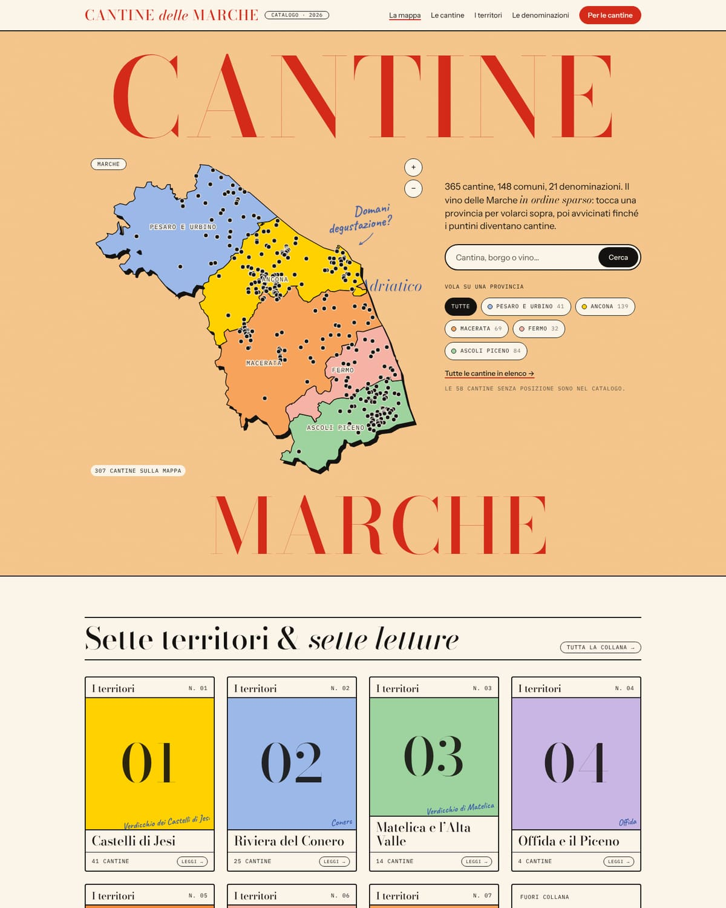

# Cantine delle Marche

Piattaforma per il vino e l'enoturismo marchigiano: scoperta delle cantine (Fase 1), claim e dashboard per i produttori (Fase 2), marketplace multi-vendor e community (Fase 3).
Lo stack previsto è Astro + Cloudflare Workers + D1/R2/KV, con deploy continuo da GitHub.

## Avvio rapido

```bash
npm install
npm run db:reset:local   # crea il D1 locale: schema + tassonomie + 365 cantine e i loro vini
npm run dev              # http://localhost:4321/cantine  (Astro su workerd, binding D1 reale)
```

Altri comandi: `npm run build` (bundle per Workers), `npm run preview` (il worker compilato con `wrangler dev`), `npm run check` (typecheck), `npm run seed:build` (rigenera i seed dall'export).

### Primo deploy su Cloudflare

```bash
npx wrangler login
npx wrangler d1 create cantine-marche          # copia il database_id in wrangler.jsonc
npx wrangler d1 migrations apply cantine-marche --remote
npx wrangler d1 execute cantine-marche --remote --file db/seed/0001_taxonomies.sql
npx wrangler d1 execute cantine-marche --remote --file db/seed/0002_catalog.sql
npm run deploy
```

## Anteprima su GitHub Pages

**https://asabatini89-del.github.io/cantinemarche/**

Ad ogni push sul branch di default, [`.github/workflows/anteprima-pages.yml`](.github/workflows/anteprima-pages.yml) costruisce il sito vero su un D1 locale, salva tutte le pagine come HTML statico ([`scripts/build-static-preview.mjs`](scripts/build-static-preview.mjs): 467 pagine, comprese le paginazioni e i filtri singoli) e le pubblica su Pages. Ricerca libera, filtri combinati e invio dei moduli richiedono il server: nell'anteprima lo spiega un avviso. La versione completa è quella su Cloudflare.

Prima volta: **Settings → Pages → Build and deployment → Source: GitHub Actions**, poi rilanciare il workflow da *Actions*.

## Il sito

Identità “Radical Chic” (manifesto e copertina anni Settanta, mappa animata): vedi [`docs/05-identita.md`](docs/05-identita.md).



| Pagina | Cosa fa |
|---|---|
| `/` | Mappa SVG delle Marche con le 307 cantine geolocalizzate (cartiglio al tocco), ricerca, province, i sette territori, le DOCG |
| `/cantine` | Catalogo dalla A alla Z: ricerca full-text, filtri provincia/denominazione/vitigno/servizi nell'URL, paginazione |
| `/cantine/[slug]` | Scheda: contatti, mappa di posizione, denominazioni, vini (ognuno rimanda alla sua fonte), fonti, cantine nei paraggi, **richiesta di visita** |
| `/territori`, `/territori/[slug]` | I sette territori come collana: copertina, denominazioni, mappa inquadrata, elenco cantine |
| `/denominazioni`, `/denominazioni/[slug]` | DOCG, DOC, IGT con le cantine che le producono |
| `/per-le-cantine` | Pagina per i produttori + **modulo di rivendicazione** della scheda |
| `/privacy` | Privacy, fonti e licenze (**bozza: completare i dati del titolare**) |
| `/sitemap.xml`, `/robots.txt`, 404 | SEO e pagine di servizio |

I moduli funzionano senza JavaScript, salvano su D1 (`visit_requests`, `contact_requests`), hanno honeypot anti-bot, limite di 5 invii l'ora per connessione (IP salvato solo come hash giornaliero) e protezione CSRF tramite controllo dell'Origin.

Per leggere le richieste arrivate:

```bash
npx wrangler d1 execute cantine-marche --remote --command "SELECT created_at, name, email, winery_id, guests, preferred_date, message FROM visit_requests ORDER BY created_at DESC LIMIT 50"
npx wrangler d1 execute cantine-marche --remote --command "SELECT created_at, kind, name, role, email, winery_id, winery_text FROM contact_requests ORDER BY created_at DESC LIMIT 50"
```

### Immagini dai siti delle cantine

La raccolta va lanciata da un computer con accesso a internet (da questo ambiente cloud i siti delle cantine e Firecrawl sono bloccati dalla policy di rete):

```bash
npm run images:fetch -- --limit 20          # prova su 20 cantine, poi senza --limit per tutte
npm run images:fetch -- --firecrawl         # opzionale: siti in JavaScript via Firecrawl (FIRECRAWL_API_KEY)
npx wrangler r2 bucket create cantine-media # una volta sola
npm run images:upload:remote                # carica su R2 e popola la tabella media
```

`scripts/fetch-images.mjs` legge la home di ogni cantina, rispetta `robots.txt`, fa una richiesta alla volta per sito e prende og:image e immagini grandi. Scarta loghi, icone, banner, grafiche piatte e duplicati, poi converte in WebP (1600 e 640 px). Raccoglie anche le immagini delle bottiglie già presenti nell'export. Il lavoro è riprendibile e produce `media-out/report.md` con l'esito di ogni cantina e `db/seed/0003_media.sql`.

In pagina ogni foto ha il credito con il link alla fonte e il collegamento “Chiedi una modifica o la rimozione”, che crea una richiesta di tipo `correction`. **Le foto restano opera delle cantine:** pubblicarle senza consenso espone a richieste di rimozione o risarcimento. Conviene evadere subito le richieste e, quando una cantina rivendica la scheda, chiederle di confermare o sostituire le foto.

### Prima di andare online

- [ ] `npx wrangler d1 create cantine-marche` e `database_id` in `wrangler.jsonc`
- [ ] `site` in `astro.config.mjs` con il dominio definitivo
- [ ] Completare `/privacy` con titolare del trattamento e contatti, e farla rivedere
- [ ] Decidere chi legge le richieste: oggi restano in D1, senza notifica email (serve un provider, es. Resend)
- [ ] `npx wrangler r2 bucket create cantine-media` e raccolta delle immagini (vedi sopra)
- [ ] Correggere alla fonte le anomalie elencate in [`data/import-report.md`](data/import-report.md)

### Prossime fasi

Fase 2 (account, verifica del claim, dashboard cantina) e Fase 3 (shop multi-vendor con Stripe Connect) sono progettate in `docs/` e lo schema D1 le prevede già. La pagina `/per-le-cantine` raccoglie già le rivendicazioni, da verificare a mano finché non c'è la dashboard.

## Contenuto del repository

| Percorso | Cosa contiene |
|----------|---------------|
| [`docs/01-user-journeys.md`](docs/01-user-journeys.md) | I tre flussi chiave: ricerca utente, riscatto cantina, acquisto multi-vendor |
| [`docs/02-stack.md`](docs/02-stack.md) | Stack consigliato, confronto D1/Supabase, CI/CD, budget di performance |
| [`docs/03-database.md`](docs/03-database.md) | Modello dati (ERD), decisioni, query tipo, logica di split dei pagamenti |
| [`docs/04-frontend-architecture.md`](docs/04-frontend-architecture.md) | Struttura dei file, route, strategia di rendering e cache, pattern mobile |
| [`db/migrations/`](db/migrations/) | Schema D1 per tutte e tre le fasi + richieste dai moduli pubblici |
| [`src/`](src/) | App Astro: `pages/` (home, cantine, territori, denominazioni, per-le-cantine, api), `components/` (MarcheMap, WineryCard, FilterBar), `lib/` (D1, filtri, mappa, moduli) |
| [`data/export-2026-10-09/`](data/export-2026-10-09/) | Export del portale attuale usato per l'import (cantine, anteprime, territori, denominazioni, licenze) |
| [`data/vini-ricerca-2026-10-10.json`](data/vini-ricerca-2026-10-10.json) | Vini trovati con ricerca web per le cantine che l'export lasciava senza: ogni vino ha l'URL della pagina che lo prova; le cantine senza fonti hanno la nota di cosa è stato cercato |
| [`data/import-report.md`](data/import-report.md) | Report dell'import: conteggi, anomalie, cantine ancora senza vini con il motivo |
| [`scripts/build-seed.mjs`](scripts/build-seed.mjs) → [`db/seed/`](db/seed/) | Normalizzazione dell'export e generazione dei seed SQL, deterministica |
| [`docs/05-identita.md`](docs/05-identita.md) | Identità visiva “Radical Chic”: principi, colori, caratteri, componenti, mappa animata, voce |

## Note rispetto ai documenti di progetto

- La mappa è un **SVG** delle province ISTAT con le cantine proiettate (proiezione stimata adattando le 307 coordinate ai poligoni: 306 cadono nella provincia giusta). Niente MapLibre né tile esterni: zero dipendenze, zero costi, coerente con l'identità. La mappa della home è navigabile (volo animato sulle province, zoom fino a ~28× con punti a dimensione costante, trascinamento e pinch) con uno script vanilla, [`src/scripts/map-explorer.ts`](src/scripts/map-explorer.ts). Le tile vettoriali restano un'opzione se servirà lo zoom stradale.
- Nessun framework di isole (Preact): bastano HTML server-side e script vanilla (filtri, esploratore della mappa).
