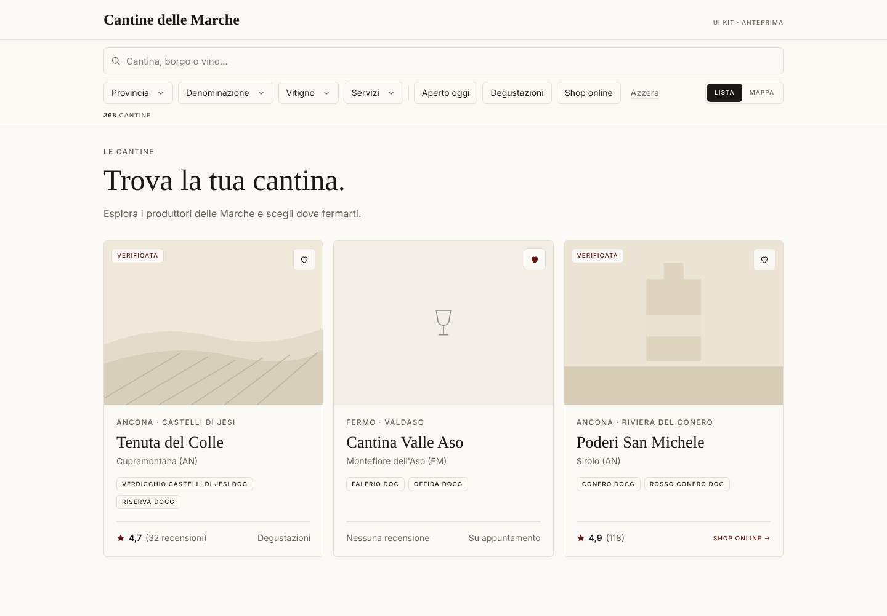
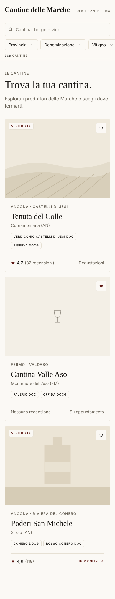
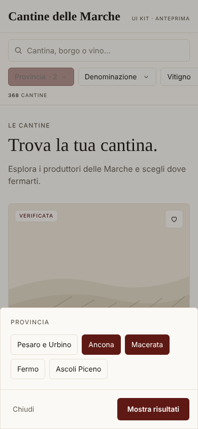

# Cantine delle Marche

Piattaforma per il vino e l'enoturismo marchigiano: scoperta delle cantine (Fase 1), claim e dashboard per i produttori (Fase 2), marketplace multi-vendor e community (Fase 3).
Lo stack previsto è Astro + Cloudflare Workers + D1/R2/KV, con deploy continuo da GitHub.

## Avvio rapido

```bash
npm install
npm run db:reset:local   # crea il D1 locale: schema + tassonomie + 365 cantine e 1.494 anteprime vini
npm run dev              # http://localhost:4321/cantine  (Astro su workerd, binding D1 reale)
```

Altri comandi: `npm run build` (bundle per Workers), `npm run preview` (il worker compilato con `wrangler dev`), `npm run check` (typecheck), `npm run seed:build` (rigenera i seed dall'export).

### Primo deploy su Cloudflare

```bash
npx wrangler login
npx wrangler d1 create cantine-marche          # copia il database_id in wrangler.jsonc
npx wrangler d1 migrations apply cantine-marche --remote
npx wrangler d1 execute cantine-marche --remote --file db/seed/0001_taxonomies.sql
npx wrangler d1 execute cantine-marche --remote --file db/seed/0002_catalog.sql
npm run deploy
```

## Stato

| Fatto | Prossimo |
|---|---|
| Catalogo `/cantine` con ricerca full-text, filtri (provincia, denominazione, vitigno, servizi) nell'URL, paginazione | Home con mappa (MapLibre) e chip territori |
| Scheda `/cantine/[slug]` con contatti, denominazioni, vini (link al sito della cantina), fonti, JSON-LD | Pagine `/territori` e `/denominazioni` |
| Import dell'export del portale attuale con report delle anomalie ([`data/import-report.md`](data/import-report.md)) | Fase 2: account, claim, dashboard cantina |

## Contenuto del repository

| Percorso | Cosa contiene |
|----------|---------------|
| [`docs/01-user-journeys.md`](docs/01-user-journeys.md) | I tre flussi chiave: ricerca utente, riscatto cantina, acquisto multi-vendor |
| [`docs/02-stack.md`](docs/02-stack.md) | Stack consigliato, confronto D1/Supabase, CI/CD, budget di performance |
| [`docs/03-database.md`](docs/03-database.md) | Modello dati (ERD), decisioni, query tipo, logica di split dei pagamenti |
| [`docs/04-frontend-architecture.md`](docs/04-frontend-architecture.md) | Struttura dei file, route, strategia di rendering e cache, pattern mobile |
| [`db/migrations/0001_init.sql`](db/migrations/0001_init.sql) | Schema D1 eseguibile per tutte e tre le fasi |
| [`src/`](src/) | App Astro: `pages/cantine`, `components/` (WineryCard, FilterBar), `lib/db.ts` (query D1), `lib/filters.ts` |
| [`data/export-2026-10-09/`](data/export-2026-10-09/) | Export del portale attuale usato per l'import (cantine, anteprime, territori, denominazioni, licenze) |
| [`scripts/build-seed.mjs`](scripts/build-seed.mjs) → [`db/seed/`](db/seed/) | Normalizzazione dell'export e generazione dei seed SQL, deterministica |
| [`ui/`](ui/) | UI kit "Editorial Gastronomy": token Tailwind v4, snippet `WineryCard` e `FilterBar`, pagina di anteprima |

## Anteprima del UI kit

```bash
cd ui
npm install
npm run build        # genera dist/index.html + dist/styles.css
open dist/index.html # oppure: npx serve dist
```

Gli snippet in `ui/snippets/` sono la fonte da cui nasceranno i componenti Astro (`WineryCard.astro`, `FilterBar.astro`).

| Desktop | Mobile | Mobile · filtro aperto |
|---|---|---|
|  |  |  |

*Screenshot generati con i font di fallback: Cormorant e Plus Jakarta Sans vengono caricati da Google Fonts nel browser.*

## Nota sul design

La direzione "Editorial Gastronomy" di questo kit (carta `#FBF9F5`, bordeaux `#5E1914`, Cormorant Garamond + Plus Jakarta Sans, solo hairline e nessuna ombra, angoli al massimo `rounded-md`) **è diversa dall'identità del portale attualmente pubblicato** (`#fef2ea` / `#31060a` con corallo, senape e oliva, DM Sans + Knewave, bottoni a pillola, ombre sfalsate, mappa SVG illustrata). Prima di procedere con i componenti va deciso se:
1. adottare il nuovo sistema ovunque (rebrand),
2. mantenere l'identità attuale e prendere dal kit solo struttura e pattern UX,
3. una via di mezzo, per esempio la mappa illustrata per la vista "territori" e la mappa vettoriale desaturata per la ricerca.
