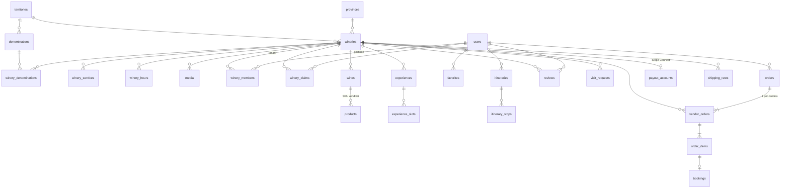

# 03 · Schema del database (D1 / SQLite)

Lo schema completo ed eseguibile si trova in [`db/migrations/0001_init.sql`](../db/migrations/0001_init.sql): 38 tabelle (più l’indice full-text FTS5), vincoli `CHECK`, indici e trigger. L'ho verificato su SQLite 3.45, con test su vincoli, FTS5 e trigger del rating.

È stato progettato **una volta per tutte e tre le fasi**: le tabelle della Fase 3 esistono già, ma restano vuote finché non servono. In questo modo non ci sono migrazioni distruttive quando si passa da una fase all'altra.

## Mappa delle entità



## Tabelle per fase

| Fase | Tabelle | Note |
|------|---------|------|
| **1 · Discovery** | `provinces`, `territories`, `denominations`, `grape_varieties`, `services`, `wineries`, `winery_denominations`, `winery_grapes`, `winery_services`, `winery_hours`, `media`, `wines`, `wine_grapes`, `wineries_fts`, `visit_requests`, `corrections` | Le 368 schede attuali entrano con `data_source='import'` e `claim_status='unclaimed'`. |
| **2 · Claim + dashboard** | `users`, `winery_members`, `winery_claims`, `experiences`, `audit_log` | La cantina è il **tenant**: `winery_members` decide chi può modificare cosa (`owner`/`editor`). |
| **3 · Marketplace + community** | `favorites`, `itineraries`, `itinerary_stops`, `reviews`, `addresses`, `products`, `experience_slots`, `carts`, `cart_items`, `orders`, `vendor_orders`, `order_items`, `bookings`, `payout_accounts`, `shipping_rates`, `payment_events`, `campaigns` | Le tabelle di sessione e account sono generate dalla CLI di Better Auth. |

## Decisioni di modellazione

1. **Vino ≠ prodotto ≠ esperienza.** `wines` è la scheda editoriale e può esistere senza shop (anche importata, con `external_url` verso il sito della cantina). `products` è lo SKU vendibile con prezzo, stock e formato. Le "anteprime importate" del portale attuale non diventano mai inventario per errore.
2. **Ordine padre + sotto-ordini.** `orders` corrisponde a un pagamento. `vendor_orders` contiene uno stato di evasione, una spedizione e un payout **per ciascuna cantina**. È la struttura che rende naturali lo split, i rimborsi parziali e le dashboard separate.
3. **Snapshot nell'ordine.** `order_items.title_snapshot`, `unit_price_cents`, `vat_rate` e gli indirizzi in JSON. Se il catalogo cambia, gli ordini storici non cambiano.
4. **Importi interi in centesimi**, IVA esplicita e prezzi IVA inclusa (B2C).
5. **Coordinate opzionali ma validate.** Se `lat`/`lng` mancano, la scheda è visibile ma senza mappa. Un `CHECK` impedisce coordinate fuori dalle Marche (refusi da import).
6. **Denormalizzazioni controllate.** `rating_avg` e `rating_count` sono aggiornati da trigger: la lista non fa `JOIN` con le recensioni.
7. **Una recensione per utente per cantina** (modificabile). `verified=1` solo se è collegata a un ordine o a una prenotazione completati. La risposta del titolare (`owner_reply`) sta nella stessa riga.
8. **Claim sicuri.** L'OTP è salvato solo come hash, con scadenza e contatore di tentativi. Un indice unico parziale impedisce richieste duplicate aperte. Ogni approvazione finisce in `audit_log`.
9. **Webhook idempotenti.** `payment_events.id` è l'`evt_…` di Stripe: un evento ricevuto due volte viene ignorato.

## Query tipo

**Marker in vista (mappa, bounding box):**
```sql
SELECT id, slug, name, lat, lng, claim_status
FROM wineries
WHERE status = 'published'
  AND lat BETWEEN ?1 AND ?2 AND lng BETWEEN ?3 AND ?4;
-- usa idx_wineries_geo (indice parziale sulle sole cantine pubblicate)
```

**Lista filtrata (provincia + denominazione + servizio), come l'URL della FilterBar:**
```sql
SELECT w.*
FROM wineries w
WHERE w.status = 'published'
  AND w.province_code IN ('AN','MC')
  AND EXISTS (SELECT 1 FROM winery_denominations d
              JOIN denominations x ON x.id = d.denomination_id
              WHERE d.winery_id = w.id AND x.slug IN ('conero','rosso-conero'))
  AND EXISTS (SELECT 1 FROM winery_services s
              JOIN services v ON v.id = s.service_id
              WHERE s.winery_id = w.id AND v.slug = 'degustazioni')
ORDER BY w.plan = 'premium' DESC, w.rating_count DESC, w.name
LIMIT 24 OFFSET ?;
```
(OR dentro lo stesso filtro, AND tra filtri diversi. È la semantica che gli utenti si aspettano.)

**Ricerca testuale:**
```sql
SELECT w.* FROM wineries_fts f
JOIN wineries w ON w.rowid = f.rowid
WHERE wineries_fts MATCH 'verdicc*' AND w.status = 'published'
ORDER BY rank LIMIT 20;
```

## Logica di split del pagamento (Fase 3)

```
checkout →  orders(pending) + vendor_orders(pending, commission_cents, payout_cents)
         →  Stripe PaymentIntent (amount = total, transfer_group = orders.id)
webhook payment_intent.succeeded (via Queue, idempotente su payment_events)
         →  orders.status = 'paid'; decremento stock; experience_slots.booked += guests
         →  per ogni vendor_order: stripe.transfers.create({ amount: payout_cents,
                destination: payout_accounts.stripe_account_id, transfer_group })
rimborso di un sotto-ordine → refund parziale + transfer reversal di quella cantina
```

Lo stock si decrementa con un `UPDATE … SET stock = stock - ?q WHERE id = ? AND stock >= ?q` dentro un `db.batch()` (transazione D1). Se una riga non viene aggiornata, la riserva fallisce prima del pagamento.

## Dati iniziali

I seed in `db/seed/` sono generati da `scripts/build-seed.mjs` a partire dall'export del portale attuale (`data/export-2026-10-09/`). Ogni cantina conserva la provenienza: `sources_json`, `data_note`, `checked_at`, `coordinate_status` (`approximate` / `osm` / `missing`) e `coordinate_source`. Le anteprime vini conservano `external_id`, `external_url`, `evidence_type` ed `external_image_url`. Quest'ultimo non viene mostrato: le foto restano della cantina.
Regole e anomalie sono descritte in [`data/import-report.md`](../data/import-report.md).

## Migrazioni

```bash
npx wrangler d1 create cantine-marche
npx wrangler d1 migrations apply cantine-marche --local    # sviluppo
npx wrangler d1 migrations apply cantine-marche --remote   # produzione
```
