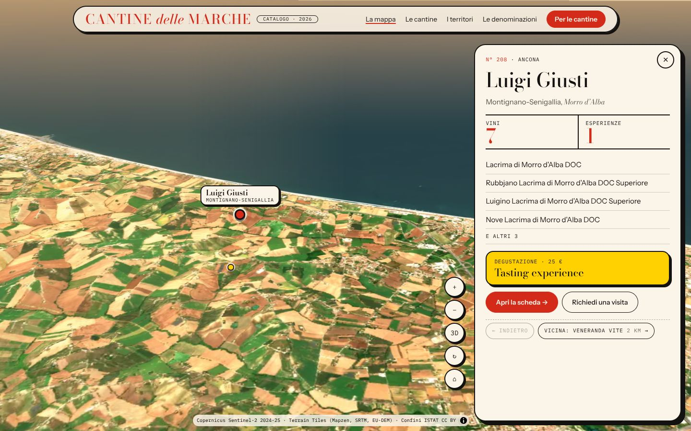
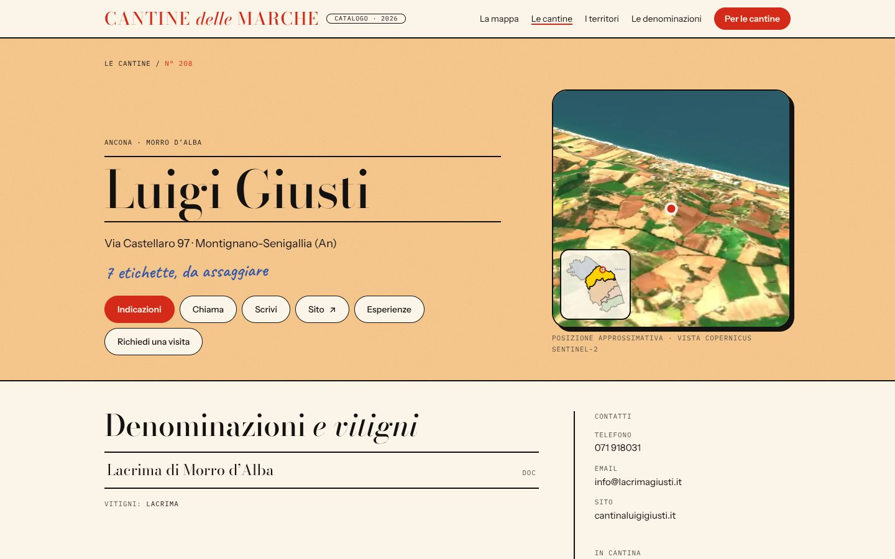
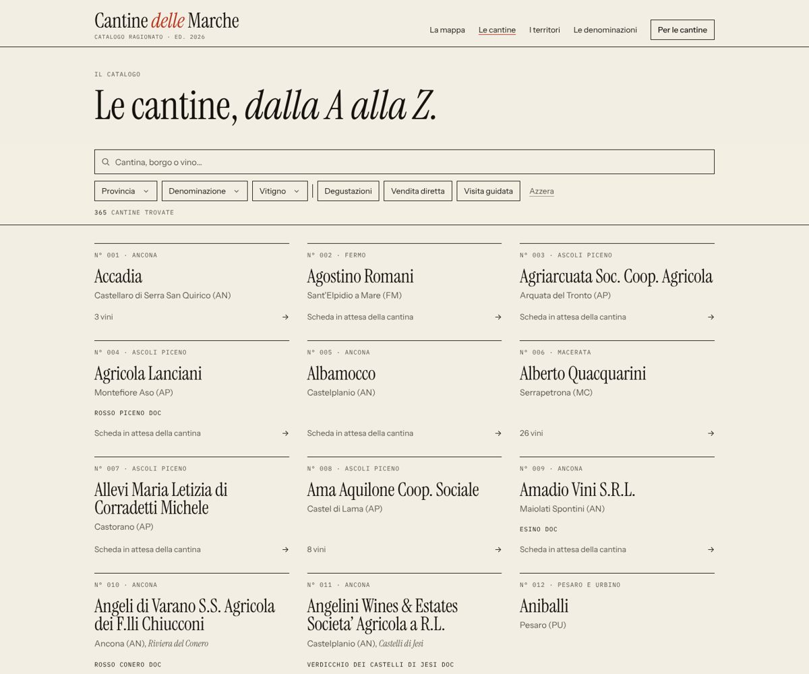
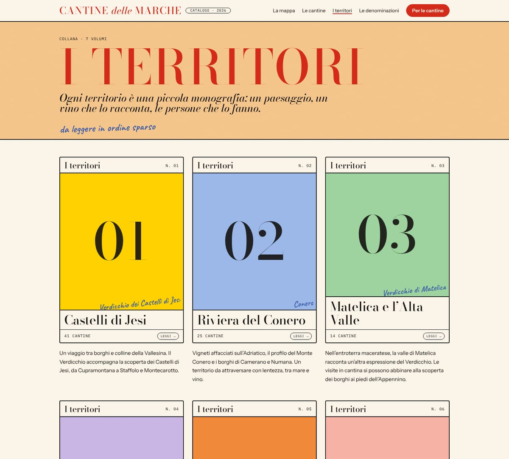
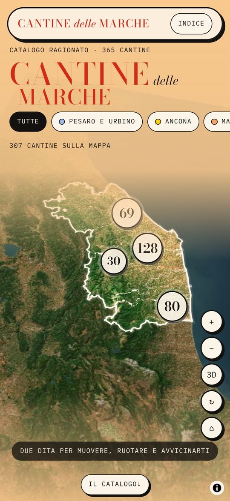

# 05 · Identità: “Radical Chic”

Il sito è un manifesto e una copertina di saggio anni Settanta insieme. Dal manifesto prende il fondo albicocca, la parola enorme in Bodoni maiuscolo vermiglio e la figura disegnata a matita blu e mandarino, con una nota scritta a mano. Dalla copertina prende il fondo crema, i titoli serif neri chiusi tra filetti spessi, i riquadri a colore pieno con contorno nero e il marchio dell'editore a pillola. Il tono è colto e ironico: “Domani degustazione?”. Niente superlativi, stelline finte o foto da stock.


## Principi

1. **Una parola, una figura, una parola.** Le pagine principali si aprono come un manifesto: la parola-manifesto (`CANTINE`, `I TERRITORI`, `DENOMINAZIONI`), poi la figura (la mappa o la mascotte), poi un'altra parola spaziata (`M A R C H E`, `S A L U T E`).
2. **È ancora un catalogo.** Ogni cantina ha il suo numero (`N° 042`, in rosso), i territori sono i volumi di una collana con le copertine alla Picador, le denominazioni sono un indice. La struttura editoriale resta la gerarchia.
3. **Il rosso è la voce alta.** Il vermiglio `#d42a1a` si usa per le parole-manifesto, i numeri di catalogo e l'azione principale. Il testo corrente resta inchiostro su crema.
4. **I colori pieni sono copertine.** Giallo, azzurro, mandarino, rosa, menta, lavanda e albicocca si usano solo come fondi pieni, con testo in inchiostro e contorno nero da 2 px. Ogni provincia e ogni territorio ha il suo.
5. **Una nota a mano per pagina.** Il Caveat in matita blu è la battuta a margine (“…e domani brunch in vigna?”). Una sola per vista, mai per informazioni essenziali.
6. **Onestà dei dati.** Fonti in nota, date di verifica, “posizione approssimativa”, “scheda in attesa della cantina”: l'incompletezza si dichiara, non si nasconde.

## Colori

| Token | Valore | Uso | Contrasto |
|---|---|---|---|
| `carta` | `#fbf4e8` | fondo di lettura (crema) | — |
| `carta-2` | `#f4e6cf` | hover, superfici | — |
| `pesca` | `#fccb8f` | fondo-manifesto: hero, testate, piè di pagina | — |
| `inchiostro` | `#141210` | testo, filetti, contorni | 17:1 su crema |
| `grafite` | `#5a5048` | testo secondario | 7,2:1 su crema, 5,3:1 su albicocca |
| `rosso` | `#d42a1a` | parole-manifesto, numeri, azione primaria | 4,6:1 su crema (crema su rosso idem) |
| `cobalto` | `#3557a8` | note a mano, focus | 4,6:1 su albicocca |
| `giallo` `azzurro` `mandarino` `rosa` `menta` `lavanda` `albicocca` | | copertine, province, hover | inchiostro ≥ 9:1 |

Province: Pesaro e Urbino azzurro, Ancona giallo, Macerata albicocca, Fermo rosa, Ascoli Piceno menta.

## Caratteri

Tutti self-hosted con `@fontsource` (nessuna richiesta a Google: più veloci e senza problemi GDPR).

| Ruolo | Carattere | Classe |
|---|---|---|
| Parole-manifesto | Bodoni Moda (variabile, ottica automatica), maiuscolo, rosso | `manifesto` (+ `spaziato` per C H I C) |
| Titoli, nomi delle cantine | Bodoni Moda tondo e corsivo | `display` |
| Testo e interfaccia | Instrument Sans (variabile) | `font-sans` (default) |
| Metadati, numeri di catalogo | IBM Plex Mono, maiuscolo, spaziato | `meta` |
| Note a margine | Caveat, matita blu | `mano` |

La testata (`PosterHeader`) adatta il corpo della parola-manifesto alla larghezza: la parola più lunga resta su una riga anche a 360 px. Evitare le maiuscole accentate nelle parole-manifesto: con interlinea 0,85 l'accento tocca la riga sopra.

## Componenti

- **Testata-manifesto** (`PosterHeader`): fondo pieno con grana da stampa (`grana`), parola-manifesto, sottotitolo corsivo, nota a mano, slot laterale per l'illustrazione.
- **Mascotte** (`Mascotte`): una bottiglia blu a matita con dolcevita mandarino a coste, capsula vermiglio e cuffie, con fumetto a mano. Compare nel blocco per i produttori, in “Per le cantine” e nella 404.
- **Copertina** (`TerritoryCover`): la collana alla Picador. Fascia crema con “I territori” e numero, riquadro a colore pieno con il numerale gigante e il vino scritto a mano, titolo tra filetti, piede con il numero di cantine e la pillola “Leggi”.
- **Pulsanti:** pillole. `btn` (contorno inchiostro da 1,5 px, si inverte all'hover) e `btn-primary` (vermiglio pieno). Un solo `btn-primary` per vista. `pillola` per etichette e filtri compatti.
- **Riquadri “in rilievo”:** contorno 2 px e ombra piena sfalsata in inchiostro (`shadow-[6px_6px_0_var(--color-inchiostro)]`), come un ritaglio di carta incollato: box “Sei il titolare?”, moduli, passi.
- **Voce di catalogo** (`WineryCard`): filetto da 2 px, `N°` in rosso, nome in Bodoni, comune e territorio, denominazioni a macchina. Hover crema scuro.
- **Filtri** (`FilterBar`): chip a pillola, pannelli a bottom sheet su mobile con angoli arrotondati, tutto in un `<form method="get">`.
- **Note:** filetto verticale rosso da 4 px + etichetta `NOTA` per gli avvisi sui dati. L'esito positivo di un modulo è un riquadro menta.

## La mappa che si muove

La home è la mappa: le Marche vere, a tutto schermo e in 3D (`src/components/MappaViva.astro` + `src/scripts/mappa-viva.ts`, MapLibre GL). Il manifesto “CANTINE delle MARCHE” sta su un velo albicocca a sinistra; il resto è satellite.

- **Le immagini:** composizione a colori naturali di Sentinel-2 dell'estate 2024 (con qualche scena 2025 per i buchi e i dintorni), senza nuvole grazie alla classificazione SCL, corretta nei colori e fusa con un rilievo ombreggiato multidirezionale. Il mare prende il colore dalla profondità. Tutto è generato da `scripts/build-tiles.py` in tile WebP auto-ospitate (vedi più sotto).
- **Il rilievo:** terreno 3D (Terrain Tiles, esagerazione 1,6), cielo e foschia calda all'orizzonte.
- **La regia d'ingresso:** la camera parte dall'alto, il contorno della regione si disegna come un tratto di penna, poi la camera scende inclinata sulla regione e i puntini delle cantine entrano a scatti. Dopo qualche secondo di quiete la mappa gira piano su se stessa (pulsante ↻ per fermarla).
- **Le province:** passando sopra, la provincia si accende del suo colore; con un clic (o una pillola “Vola su una provincia”) la camera ci vola sopra, le altre si spengono e il conteggio si aggiorna. `#provincia-AN` nell'indirizzo per condividere la vista.
- **Le cantine:** puntini colorati per provincia, raggruppati in cerchi numerati finché sono troppo vicini (un clic sul cerchio avvicina). Un clic sulla cantina fa volare la camera fino a lei (inclinata, ruotando un poco), apre la scheda a molla con vini, esperienze e azioni e manda via il manifesto; “Vicina” salta alla cantina più vicina non ancora vista, “Indietro” ripercorre il giro. `#cantina-…` nell'indirizzo, Esc per chiudere.
- **Dalla mappa alla scheda:** il nome della cantina vola dalla mappa (o dalla card del catalogo) al titolo della sua pagina con le View Transitions tra documenti.
- **Gesti:** su desktop la rotellina avvicina con Ctrl/⌘, così la pagina scorre normalmente; su mobile si usano due dita. La scheda su mobile sale dal basso.
- Con `prefers-reduced-motion` niente voli né giri: la camera salta. Senza WebGL, o se le tile non ci sono, resta la mappa illustrata a ritagli di carta (`MarcheMap explore` + `src/scripts/map-explorer.ts`); senza JavaScript un SVG con un link per cantina.



### Le tile

```bash
python -m venv .venv-tiles && .venv-tiles/bin/pip install -r scripts/requirements-tiles.txt
.venv-tiles/bin/python scripts/build-tiles.py      # ~60 MB in public/tiles (non versionate)
```

Le scene sono fissate in `data/sentinel-scenes.json` (in ordine di priorità), così il risultato è riproducibile. Lo zoom va da 6 a 12 per le immagini (512 px) e da 6 a 11 per la quota; oltre lo zoom 10 si generano solo le tile vicine alla regione. Il workflow di anteprima le genera e le tiene in cache finché non cambiano script, scene o confini. Per il deploy su Cloudflare vanno generate prima di `npm run deploy`.

## Voce

| Sì | No |
|---|---|
| “Il vino delle Marche, *in ordine sparso.*” | “Scopri le migliori cantine!” |
| “Domani degustazione?” (a margine) | “Prenota subito la tua esperienza!” |
| “Scheda in attesa della cantina” | “Nessuna informazione disponibile” |
| “Con questi filtri il catalogo resta in silenzio.” | “0 risultati trovati” |
| “Non è una prenotazione: ti risponderanno.” | “Prenota ora!” |



| Catalogo | Territori | Mobile |
|---|---|---|
|  |  |  |
